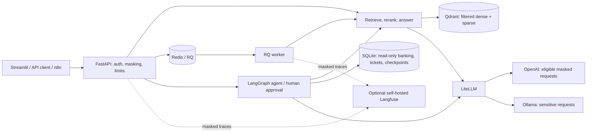

# bank-assistant

An internal banking assistant for document-grounded answers with file/page
citations, department-based access, PII masking, queued requests and small agent
tools with human approval. The API is the integration boundary; Streamlit is a
local demonstration client and n8n supplies optional approval workflows.

The MVP uses public documents and synthetic customer data. Release readiness and
remaining limits are recorded in the [v1.0-mvp QA report](.agent/reports/releases/RELEASE-v1.0-mvp.md).
The report is evidence, not an announcement of a production release.

## What it does

- Retrieve documents using dense/sparse hybrid search and reranking; refuse when
  supported information or a valid citation is missing.
- Apply public/credit/hr access filters inside retrieval and exclude superseded documents.
- Mask PII before model calls, queue/checkpoint persistence, backend logs and traces.
- Route sensitive requests to a local model; send eligible requests through the cloud gateway.
- Calculate loan schedules, read the caller's synthetic transactions and propose
  tickets that require a different authenticated approver before a write.
- Expose `/ask`, `/chat`, `/ask/jobs`, `/agent`, approval and feedback endpoints.

## Architecture



[Architecture and trust boundaries](docs/02-architecture/architecture.md) describes
the implemented topology. The four ADRs document [hybrid retrieval](docs/02-architecture/adr/0001-qdrant-hybrid.md),
[model routing](docs/02-architecture/adr/0002-hybrid-model-routing.md),
[RBAC filters](docs/02-architecture/adr/0003-payload-rbac.md) and
[RQ jobs](docs/02-architecture/adr/0004-rq-queue.md).

## Quick start: reproducible fake-backend demo

Use Bash on Linux or WSL, Git, Python 3.10+, GNU Make, curl and Docker Engine with
Compose v2 or newer. Keep loopback ports 8000, 6333, 6379 and 4000 free. The first
image build downloads large CPU/ML dependencies; allow network access and disk
space. Pip allows 120-second reads and five connection retries; exhausted
downloads still fail visibly.

The default fake RAG/LLM/auth setup needs no provider key, PDFs, snapshot, model
weights or host Python packages. It starts the real API, worker, Redis, Qdrant and
gateway; its canned answers demonstrate wiring, not banking knowledge or model quality.

```bash
git clone https://github.com/T1xNTH/bank-assistant.git
cd bank-assistant
cp .env.example .env.local
python3 - <<'PY'
from pathlib import Path
import secrets
path = Path(".env.local")
lines = path.read_text().splitlines(keepends=True)
marker = "LITELLM_MASTER_KEY=\n"
if lines.count(marker) != 1:
    raise SystemExit("Expected exactly one empty LITELLM_MASTER_KEY line in .env.example")
lines[lines.index(marker)] = "LITELLM_MASTER_KEY=sk-" + secrets.token_hex(32) + "\n"
path.write_text("".join(lines))
PY
make up
make smoke
docker compose -f infrastructure/compose.yaml --env-file .env.local exec -T api \
  python - < scripts/smoke_api.py
```

Expected: five healthy core services, `/health` OK, Qdrant ready, Redis `PONG`,
then `API smoke passed`. Redis is required even for fake `/ask`, `/chat` and jobs.

Seed the API's synthetic banking volume once, then check chat, a real worker job,
synthetic-owner isolation and read-only SQLite:

```bash
docker compose -f infrastructure/compose.yaml --env-file .env.local exec -T api \
  python - --path /app/data/core_banking.db < scripts/seed_core_banking.py
docker compose -f infrastructure/compose.yaml --env-file .env.local exec -T api \
  python - < scripts/smoke_release.py
```

An existing seed database is refused; do not delete it just to rerun setup.
`make down` stops the stack and preserves named data volumes. Use a unique
`COMPOSE_PROJECT_NAME` for an isolated run, while still freeing the published ports.
The [clean-clone workflow](.github/workflows/release-qa.yml) repeats these checks
from tracked files and empty volumes, rejects reseeding and verifies restart persistence.

## Interactive UI and five-minute demo

The UI runs on `http://127.0.0.1:8501`. Its labels and example banking questions
are Vietnamese. First install the lightweight UI dependencies:

```bash
python3 -m venv .venv
.venv/bin/python -m pip install -r requirements-ui.txt
```

Generate three distinct identities from the repository root. Each command prints
one secret key; copy it into the matching `.env.local` variable and keep it private:

```bash
python3 scripts/make_key.py --user-id synthetic-user-1 --department credit --role staff
python3 scripts/make_key.py --user-id synthetic-user-2 --department hr --role staff
python3 scripts/make_key.py --user-id demo-approver --department credit --role approver
```

| Setting in `.env.local` | Value |
|---|---|
| `AUTH_BACKEND` | `apikey` |
| `UI_KEY_CREDIT_STAFF` | First generated key |
| `UI_KEY_HR_STAFF` | Second generated key |
| `UI_KEY_APPROVER` | Third generated key |
| `UI_API_URL` | `http://127.0.0.1:8000` |

Keys are issued into `config/api_keys.json` as SHA-256 digests; the API mounts that
directory read-only. Fake authentication always uses `dev` and cannot demonstrate
distinct users or approvals. Apply the authentication change before opening the UI:

```bash
make up
make ui
```

Choose a sidebar role and open **Hỏi đáp tài liệu** for questions or **Agent và
duyệt** for agent actions. The default fake LLM does not select tools: a greeting
and canned document answer work, but the loan/transaction/ticket presentation
requires the real-model preflight below. The role selector is a trusted local demo
control; the API determines permissions from the actual key, not the label.

Follow the [five-minute demo script](docs/00-project/demo-script.md) for the timed
role/citation, access-boundary, sensitive-routing and human-approval presentation,
including preflight, expected outcomes and an explicitly labelled controlled rehearsal.

## Real documents and models

Set `RAG_BACKEND=real`, `LLM_BACKEND=litellm` and `AUTH_BACKEND=apikey` in your private
`.env.local`, configure the provider key for LiteLLM, and enable local inference:

```bash
make up PROFILE=local-llm
docker compose -f infrastructure/compose.yaml --env-file .env.local exec ollama \
  ollama pull qwen2.5:3b
```

Restore the pinned **2819-point** corpus or reconstruct/ingest the source documents
before asking real questions. Follow [CI snapshot/checksum instructions](docs/07-development/ci.md),
[corpus setup](docs/07-development/corpus.md), [ingestion](docs/07-development/ingest.md)
and [gateway verification](docs/07-development/llm-gateway.md).
PDFs and model weights are not committed. First real retrieval downloads embedding
and reranking weights; warm them before the timed demo. Provider calls consume quota.

Among Compose services, only the gateway receives `OPENAI_API_KEY`; API and worker use its separate
`LITELLM_MASTER_KEY`. Requests with PII, confidential/unknown classification or
`force_local` use `local-chat` with no cloud fallback. A healthy gateway alone does
not prove either model can answer: run the documented synthetic model smoke checks.

## Evaluation and known limits

The latest committed full-golden evidence is T-038, **50 questions per mode**;
these are saved results, not a new evaluation triggered by reading this README:

| Metric | Required | `dense` | `hybrid` | `hybrid_rerank` (application default) |
|---|---|---|---|---|
| Faithfulness | >= 0.80 | 0.9010 | 0.8286 | 0.8929 |
| Hit@5 | >= 0.75 | 0.875 | 0.900 | 0.900 |
| Out-of-scope refusal | >= 0.90 | 1.00 | 1.00 | 1.00 |
| Citation rate among answered in-scope questions | 1.00 | 1.00 | 1.00 | 1.00 |
| In-scope questions answered | Reported | 32/40 | 35/40 | 35/40 |

[Generated report](docs/12-ai/rag-eval-report.md), [limitations and trace measurements](docs/12-ai/rag-eval-notes.md)
and [saved-result hashes/recomputed metrics](docs/09-testing/evidence/T-041-eval-summary.json)
retain provenance. Missing citations become refusals; a 100% citation rate does not
mean every in-scope question was answered. Judge scores vary; current eval takes
the median of three judgments, while the saved T-038 results predate that change.

Prior Langfuse `/ask` p95: **8.746s OpenAI/cloud**, **21.899s local**, **19.185s combined**.
The cloud route meets the SRS's OpenAI latency target; mixed/local latency remains
an explicit gap. These are earlier HTTP measurements, not fake-demo or in-process timings.
The public 10-question CI gate does not replace the full corpus, RBAC or local-model QA.

## Operations and development

Optional independent profiles: `make up PROFILE=automation` (n8n/Mailpit),
`PROFILE=obs` (self-hosted Langfuse), `PROFILE=local-llm` (Ollama).
All published service ports bind to loopback. Data persists in Compose volumes;
host-side seed files are separate from the API's `/app/data` volume.

[Runtime guide](docs/07-development/runtime-guide.md) preserves the detailed agent,
queue/rate-limit, backup/restore and profile procedures. The agent uses one API
process for approval locking; its amount vault is in memory. Ticket, checkpoint
and audit writes are separate transactions: reconcile a ticket after a 503 before
creating a replacement. Agent endpoints currently lack the API token bucket used
by `/ask`, `/chat` and `/ask/jobs`. Retry budgets are finite; repeated provider
outages can still fail jobs.

For full host-side development dependencies and required checks:

```bash
make setup                      # .venv + dev/UI dependencies
make check                      # Ruff + pytest + framework validation
```

To run the API directly on the host, first stop the Compose API to free port 8000,
load `.env.local` into the shell (`set -a; . ./.env.local; set +a`), then use
`.venv/bin/uvicorn app.main:app --app-dir src --port 8000`. Keep the Compose Redis
running: `/ask`, `/chat` and jobs need it even with fake backends.

Use [CONTRIBUTING.md](CONTRIBUTING.md) and the [team workflow](docs/07-development/team-workflow.md)
for lifecycle, independent review and counterpart approval. [AGENT.md](AGENT.md)
governs repository records; four architecture ADRs record existing decisions and
do not authorize new scope or a release.

## Documentation map

| Topic | Entry point |
|---|---|
| Requirements and delivery | [SRS](docs/01-business/srs.md), [product plan](docs/00-project/product-plan.md) |
| Architecture and decisions | [Architecture](docs/02-architecture/architecture.md), [ADRs](docs/02-architecture/adr/index.md) |
| API | [OpenAPI](docs/04-api/openapi.yaml), [internal contracts](docs/04-api/contract.md) |
| Security | [Trust, masking and access policy](docs/06-security/security-design.md) |
| Demo | [Five-minute script and preflight](docs/00-project/demo-script.md) |
| Integrations and tracing | [n8n](docs/11-integrations/n8n.md), [observability](docs/13-observability/observability.md) |
| Evaluation | [Runner instructions](docs/07-development/eval.md), [quality notes](docs/12-ai/rag-eval-notes.md) |
| Release evidence | [v1.0-mvp QA](.agent/reports/releases/RELEASE-v1.0-mvp.md), [CI](docs/07-development/ci.md) |
| Team process | [Team workflow](docs/07-development/team-workflow.md), [`scripts/agent` lifecycle CLI](docs/07-development/agent-cli.md) |
| Code and infrastructure | `src/app/` (application), `ui/` (Streamlit), `infrastructure/` (Dockerfile, Compose, LiteLLM, n8n), `.agent/` (planning, task board, governance, reports) |

## Process

Managed with [Agentic SDLC Kit](https://github.com/toilatrung/agentic-sdlc-kit); `AGENT.md` is the
operating policy: roadmap → milestone → epic → task; executor → independent reviewer in a separate
session (DEC-004) → counterpart approval → QA per epic → release report.
