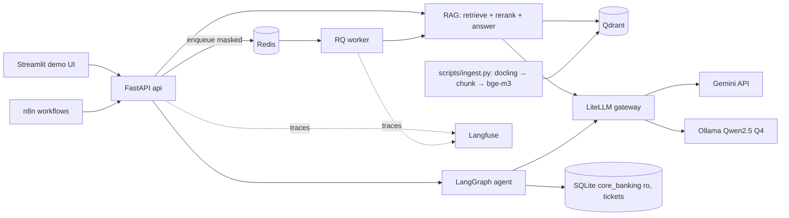

# Kiến trúc — bank-assistant MVP

## Trạng thái input

- **Status**: `ingested`
- **Authority**: `draft — pending approval in DEC-001`
- **Source Artifact**: `docs/00-project/product-plan.md`
- **Ingested Date**: `2026-10-24`
- **Validated By**: `trong-hung`, `teammate-b`

## Bối cảnh hệ thống

Nhân viên (qua UI demo hoặc cổng nội bộ) và các workflow n8n gọi API bằng API key. API trả lời dựa trên index tài liệu nội bộ, chỉ gọi LLM qua gateway, và ghi trace. Không có gì ra khỏi mạng ngoại trừ lời gọi tới LLM cloud, và LLM cloud chỉ nhận văn bản đã che; request nhạy cảm được route sang model local.

## Thành phần và trách nhiệm

| Thành phần | Code | Owner | Runtime | Ghi chú |
|---|---|---|---|---|
| API | `src/app/main.py`, `schemas.py` | B | compose `api` :8000 | FastAPI, dependency xác thực, định dạng lỗi chung |
| Auth / RBAC / audit | `src/app/security/{auth,audit}.py` | B | trong api | Key đã hash → `User`; audit trong `data/audit.db` |
| PII | `src/app/security/pii.py` | B | trong api + worker | Presidio (regex recognizer, không dùng model spaCy) + regex VN |
| RAG | `src/app/rag/*` | A | trong api + worker | parse_docling, chunk, embed (bge-m3 dense+sparse), store, retrieve (RRF), rerank, answer |
| Routing | `src/app/routing.py` | A | trong api | PII/mật → `local-chat`, còn lại → `cloud-chat` |
| Client LLM gateway | `src/app/llm.py` | B | trong api | Nơi duy nhất gọi LLM (endpoint tương thích OpenAI của LiteLLM) |
| Agent | `src/app/agent/*` | A (graph, tools) / B (SQLite, endpoints) | trong api | LangGraph, ToolNode, `interrupt` cho `tao_ticket` |
| Hàng chờ | `src/app/queue/*` | B | compose `redis`, `worker` | RQ, hàng chờ theo priority, giới hạn worker bằng token bucket |
| Observability | `src/app/tracing.py`, `llm_cost.py` | B | compose profile `obs` | Langfuse tự host |
| Tự động hoá | `infrastructure/n8n/` | B | compose profile `automation` | n8n + Mailpit |
| UI | `ui/app.py` | A | local | Streamlit, chọn role → API key |
| Eval | `eval/` | A | CLI / CI | Judge RAGAS = Gemini |

## Topology triển khai

Docker Compose (`infrastructure/compose.yaml`), chỉ bind vào `127.0.0.1`. Lõi: `api`, `worker`, `redis`, `qdrant`, `litellm`. Profile: `local-llm` (`ollama`), `automation` (`n8n`, `mailpit`), `obs` (bộ Langfuse). Cổng: 8000 api, 6333 qdrant, 6379 redis, 4000 litellm, 11434 ollama, 5678 n8n, 8025 mailpit, 3000 langfuse.

## Luồng dữ liệu và ranh giới tin cậy

1. Request → xác thực (key → `User`) → **che PII** → (đồng bộ) RAG / (bất đồng bộ) đưa payload đã che vào hàng chờ.
2. Filter khi retrieval: `department ∈ {user.department, "public"}` AND `superseded_by IS NULL`, áp ngay trong truy vấn Qdrant (không bao giờ chỉ lọc sau).
3. Quyết định routing dựa trên loại PII trong kết quả che + `classification` cao nhất của các chunk lấy được.
4. Chỉ gọi LLM qua gateway; cloud chỉ nhận văn bản đã che.
5. Output được che thêm lần nữa trước khi trả về, ghi log, ghi trace.
6. Mỗi request một dòng audit: user, endpoint, câu hỏi đã che, route, có từ chối không, latency, chi phí, trace_id.

## Hợp đồng nội bộ

Định nghĩa trong `src/app/contracts.py` và mô tả trong `docs/04-api/contract.md`. Mỗi hợp đồng có một fake trong `tests/fakes.py`; `RAG_BACKEND` / `LLM_BACKEND` chuyển giữa fake và thật để A và B không bao giờ chặn nhau.

## Các quyết định chính

Ghi thành governance decision (ADR) trong `.agent/governance/decisions/` — Qdrant hybrid (A), routing model lai (A), RBAC dạng payload filter (B), hàng chờ bằng RQ (B).

## Related Files

- SRS: `docs/01-business/srs.md`
- Contract: `docs/04-api/contract.md`
- Dữ liệu: `docs/05-database/schema.md`
- Bảo mật: `docs/06-security/security-design.md`

## Forbidden Actions

- Không gọi LLM ở ngoài `app/llm.py`.
- Không chỉ áp RBAC sau khi retrieval.
- Không ghi log hay đưa vào hàng chờ văn bản chưa che.
