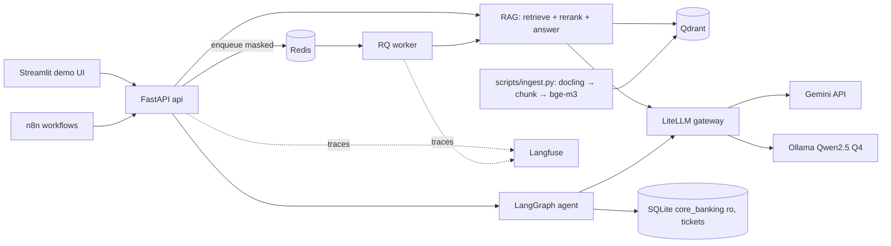

# Architecture — bank-assistant MVP

## Input Status

- **Status**: `ingested`
- **Authority**: `draft — pending approval in DEC-001`
- **Source Artifact**: `docs/00-project/product-plan.md`
- **Ingested Date**: `2026-10-24`
- **Validated By**: `trong-hung`, `teammate-b`

## System Context

Staff (via demo UI or internal portal) and n8n workflows call the API with an API key. The API answers from an internal document index, calls LLMs only through a gateway, and records traces. Nothing leaves the network except calls to the cloud LLM, which only ever receive masked text; sensitive requests are routed to the local model.

## Components and Responsibilities

| Component | Code | Owner | Runtime | Notes |
|---|---|---|---|---|
| API | `src/app/main.py`, `schemas.py` | B | compose `api` :8000 | FastAPI, auth dependency, error envelope |
| Auth / RBAC / audit | `src/app/security/{auth,audit}.py` | B | in api | Hashed keys → `User`; audit in `data/audit.db` |
| PII | `src/app/security/pii.py` | B | in api + worker | Presidio (regex recognizers, no spaCy model) + VN regex |
| RAG | `src/app/rag/*` | A | in api + worker | parse_docling, chunk, embed (bge-m3 dense+sparse), store, retrieve (RRF), rerank, answer |
| Routing | `src/app/routing.py` | A | in api | PII/confidential → `local-chat`, else `cloud-chat` |
| LLM gateway client | `src/app/llm.py` | B | in api | Single place that calls LLMs (LiteLLM OpenAI-compatible endpoint) |
| Agent | `src/app/agent/*` | A (graph, tools) / B (SQLite, endpoints) | in api | LangGraph, ToolNode, `interrupt` for `tao_ticket` |
| Queue | `src/app/queue/*` | B | compose `redis`, `worker` | RQ, priority queues, token-bucket worker limit |
| Observability | `src/app/tracing.py`, `llm_cost.py` | B | compose profile `obs` | Langfuse self-host |
| Automation | `infrastructure/n8n/` | B | compose profile `automation` | n8n + Mailpit |
| UI | `ui/app.py` | A | local | Streamlit, role selector → API key |
| Eval | `eval/` | A | CLI / CI | RAGAS judge = Gemini |

## Deployment Topology

Docker Compose (`infrastructure/compose.yaml`), host-bound to `127.0.0.1`. Core: `api`, `worker`, `redis`, `qdrant`, `litellm`. Profiles: `local-llm` (`ollama`), `automation` (`n8n`, `mailpit`), `obs` (Langfuse stack). Ports: 8000 api, 6333 qdrant, 6379 redis, 4000 litellm, 11434 ollama, 5678 n8n, 8025 mailpit, 3000 langfuse.

## Data Flows and Trust Boundaries

1. Request → auth (key → `User`) → **mask PII** → (sync) RAG / (async) enqueue masked payload.
2. Retrieval filter: `department ∈ {user.department, "public"}` AND `superseded_by IS NULL`, applied inside Qdrant query (never post-filter only).
3. Routing decision uses mask result types + max `classification` of retrieved chunks.
4. LLM call through gateway only; cloud receives masked text only.
5. Output masked again before response, log, trace.
6. Audit row per request: user, endpoint, masked question, route, refused, latency, cost, trace_id.

## Internal Contracts

Defined in `src/app/contracts.py` and documented in `docs/04-api/contract.md`. Each contract has a fake in `tests/fakes.py`; `RAG_BACKEND` / `LLM_BACKEND` switch fake vs real so A and B never block each other.

## Key Decisions

Recorded as governance decisions (ADRs) in `.agent/governance/decisions/` — Qdrant hybrid (A), hybrid model routing (A), RBAC as payload filter (B), queue via RQ (B).

## Related Files

- SRS: `docs/01-business/srs.md`
- Contract: `docs/04-api/contract.md`
- Data: `docs/05-database/schema.md`
- Security: `docs/06-security/security-design.md`

## Forbidden Actions

- Do not call an LLM outside `app/llm.py`.
- Do not apply RBAC only after retrieval.
- Do not log or enqueue unmasked text.
