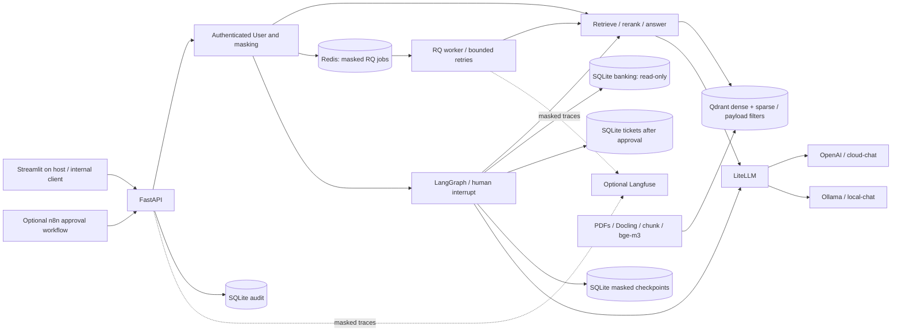

# Architecture — bank-assistant MVP

## Scope and authority

This describes the implemented source at main 5819d50 and the documentation-only
T-043 follow-up. It records the architecture authorized by DEC-001 and existing
approved changes, including the OpenAI gateway migration in CR-008. It does not
approve a new architecture, contract, production release or requirement deviation.

## System context

Staff use the API directly, through the trusted local Streamlit demo, or through
n8n. FastAPI authenticates API keys, masks request data and delegates to RAG,
queued work or the LangGraph agent. All model requests go through `app/llm.py`
and the authenticated LiteLLM gateway. Eligible masked public/internal context
can go to OpenAI; sensitive requests stay on the local alias without cloud fallback.

## Components and deployment

| Component | Source | Deployment / responsibility |
|---|---|---|
| HTTP API | `src/app/main.py`, `schemas.py`, `deps.py` | Core `api`, loopback :8000; contracts and sanitized errors |
| Identity / masking / audit | `src/app/security/`, `log_config.py` | API/worker; hashed key registry, trusted User, fail-closed masking and audit |
| Retrieval and answer | `src/app/rag/` | API/worker; bge-m3 dense+sparse, Qdrant RRF, reranker, citation/refusal validation |
| Routing and LLM client | `routing.py`, `llm.py` | Select alias locally; only LLM client issues authenticated inference HTTP |
| Agent | `src/app/agent/` | One API process; read-only tools, approved ticket writes and persistent masked checkpoints |
| Async jobs | `src/app/queue/` | Core Redis :6379 and worker; role priority, owner-bound polling and bounded retry/rate budgets |
| Vector store | `infrastructure/compose.yaml` | Core Qdrant v1.12.4 :6333; named persistent volume |
| Gateway | `infrastructure/litellm/config.yaml` | Core LiteLLM :4000; provider key only in this Compose service |
| Local inference | Compose `local-llm` profile | Ollama :11434; explicitly pull model weights |
| Automation | `infrastructure/n8n/workflows/` | `automation` profile: n8n :5678, Mailpit :8025 / SMTP :1025 |
| Observability | `tracing.py`, `llm_cost.py`, Compose `obs` | Self-hosted Langfuse :3000 plus its worker/data services; optional |
| UI | `ui/app.py`, `ui/ui_api.py` | Host `make ui`, loopback :8501; role-key mapping, no independent authorization boundary |
| Evaluation | `eval/run.py`, `eval/thresholds.json` | CLI / selected-path CI; full golden set and separate public smoke subset |

The five core Compose services are `api`, `worker`, `redis`, `qdrant`, `litellm`.
Each optional profile can start independently with core services. Published ports
bind to loopback. Named volumes persist audit/agent SQLite, Qdrant, model caches
and optional service data; host-side `data/core_banking.db` is a different file
from the API's `/app/data/core_banking.db`.

Defaults are fake RAG, LLM and authentication for reproducible startup. They do
not establish real model, document or department behavior. `AUTH_BACKEND=apikey`
and distinct generated identities are required for the role/approval demo.
Gateway liveness is separate from model readiness; missing Ollama never triggers
a cloud fallback for sensitive input.

## Request and trust boundaries

1. Resolve a trusted `User` from the API-key digest and registry. UI labels and
   model arguments cannot grant a department, role or transaction owner.
2. Mask request text before inference, queue/checkpoint storage, backend logs or
   traces. A masking failure stops processing. The local UI still holds the raw
   text entered by its operator in session history; it is not an anonymization service.
3. The API applies a shared Redis token bucket to `/ask`, `/chat`, `/ask/jobs`.
   Missing Redis fails those endpoints closed. Agent routes currently have no such bucket.
4. Retrieval applies `department in {public, user.department}` and
   `superseded_by IS NULL` inside each Qdrant query branch before fusion/top-k.
   Classification controls model routing, not cross-department authorization.
5. PII, `force_local`, confidential or unknown classification selects `local-chat`;
   otherwise public/internal content is eligible for `cloud-chat`. Sensitive history
   remains local across agent turns. Queue workers detect older masked PII placeholders too.
6. An answer needs usable content plus valid file/page citations. Missing citations,
   no permitted hits or refusal conditions return a safe refusal. A citation alone
   does not prove factual correctness; quality is separately measured by evaluation.
7. Free model output is masked at egress. Code-rendered loan/transaction answers
   preserve verified amounts and already-masked strings via internal `answer_source`;
   they are not passed through the model again. Logs/audit still mask both paths.
8. `tao_ticket` proposes and interrupts without writing. A different authenticated
   approver can approve/reject once. Owner binding comes from trusted thread state,
   not the model. Unknown/foreign threads are hidden; replay returns 409.

`/ask/jobs` stores masked JSON, pseudonymous ownership and sanitized results in
Redis. Approvers receive `ask-high` priority; other users use `ask-default`, with
legacy `ask` drained last. Polling is owner-bound. Waiting/result TTL, finite retry
budgets, shared worker rate limits and fail-closed outage behavior are explicit;
pseudonymized user IDs are not guaranteed anonymous.

## Persistence and failure boundaries

- Core-banking SQLite is read-only and requires explicit synthetic seeding.
  Role elevation does not grant another user's transactions.
- Agent checkpoints persist masked state, but the amount vault is in memory and
  expires; after restart the agent may ask for an amount again.
- One API process supplies the approval locks. More API processes require a
  shared locking design; this MVP does not claim that support.
- Ticket, checkpoint and audit writes are separate transactions. A 503 may follow
  a committed ticket; reconcile before retrying the proposal.
- Worker health uses Redis registration/heartbeat and has a documented stale
  registration window after an abrupt kill. Docker health failure alone is not autoheal.
- Qdrant recovery verifies snapshot checksum, collection and exact count, refuses
  an existing destination and requires paused writers. Equal-count concurrent
  updates are outside that count check's guarantees.

## Decisions, verification and limits

The [ADR index](adr/index.md) records four existing decisions: hybrid retrieval,
hybrid model routing, payload RBAC and RQ jobs. [Contracts](../04-api/contract.md),
[security design](../06-security/security-design.md), [runtime guide](../07-development/runtime-guide.md)
and [CI](../07-development/ci.md) provide the detailed procedures and tests.

The full saved T-038 eval has 50 questions per mode; the public CI gate has 10
questions and current median judging. Neither a fake demo nor a subset replaces
full-corpus, confidential/local routing or RBAC QA. Recorded OpenAI p95 8.746s
meets its target; combined 19.185s and local 21.899s remain disclosed latency gaps.
There is no HA, SSO, production TLS, load-test or release-certification claim.
