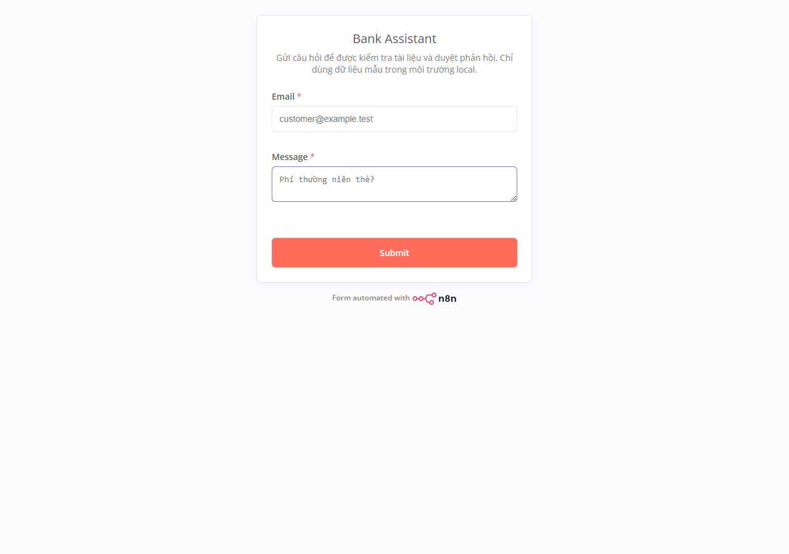
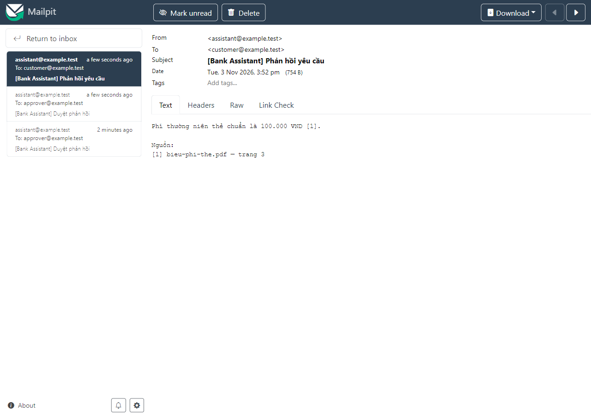
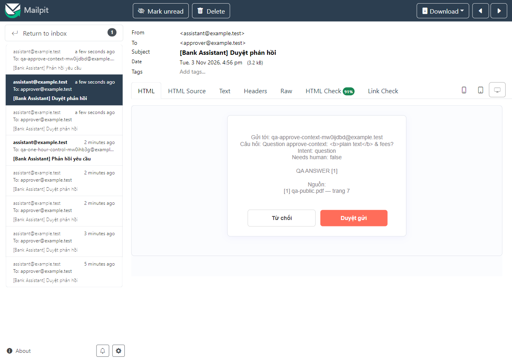

# Tích hợp n8n (FR-08, owner B; prompt phân loại do A phụ trách)

Các workflow được export vào `infrastructure/n8n/workflows/`:
1. `intake-to-reply.json` — trigger Form/Email → phân loại (`/chat`) → `/ask/jobs` + poll bằng node Wait → duyệt (Send and Wait) → phản hồi qua Mailpit.
2. `error-handler.json` — Error Trigger → báo cho người vận hành.

n8n xác thực bằng một API key dịch vụ riêng (department `public`). Webhook dùng URL production.

## Khởi chạy và import (T-033)

Yêu cầu Docker Compose, file `.env.local` từ `.env.example` và gateway key được điền.

```bash
make n8n-up
make n8n-import
# API + Redis + worker phải đang chạy để xử lý job:
make up
```

Profile `automation` thêm n8n `2.45.7` ở <http://127.0.0.1:5678> và Mailpit
`1.33.0` ở <http://127.0.0.1:8025> (SMTP host `mailpit`, port `1025` trong mạng
Compose). Các port host chỉ bind `127.0.0.1`. Dữ liệu n8n và encryption key tự sinh
được giữ trong volume `n8n_data`; giữ volume này khi khởi động lại. Có thể kết hợp
`COMPOSE_PROFILES=automation,local-llm`. `make n8n-up` chỉ bật hai dịch vụ automation;
`make up` với profile đã chọn bật cả API/worker và các dependency.

Service n8n đặt `EXECUTIONS_TIMEOUT_MAX=90000` (25 giờ), khớp
`settings.executionTimeout=90000` của workflow: 24 giờ để duyệt và 1 giờ dự phòng
cho tiếp nhận, polling và gửi thư. n8n 2.45.7 mặc định chặn timeout workflow ở
3600 giây nếu không đặt biến này. Khi đổi thời gian duyệt, cập nhật cả hai giới hạn;
đổi environment cần recreate container bằng `make n8n-up`.

`make n8n-import` dùng CLI chính thức: import `bankErrorHandler` trước rồi
`bankIntakeToReply`; chạy lại cập nhật cùng hai workflow. Workflow được import ở trạng thái chưa publish, không chứa secret
hay dữ liệu mẫu pin. Dừng/unpublish workflow trước khi import lại và publish lại sau
khi kiểm tra; không dùng CLI import đồng thời với việc sửa workflow trên editor.

1. Tạo tài khoản owner local ở lần mở n8n đầu tiên.
2. Tạo API key riêng bằng `python scripts/make_key.py --user-id n8n-service
   --department public --role service`. Lệnh chỉ lưu SHA-256 vào registry; lưu giá trị
   được in một lần vào credential n8n, không commit hoặc đưa vào workflow. Chọn
   `AUTH_BACKEND=apikey` cho API và worker rồi khởi động lại chúng. Registry phải nằm
   đúng đường dẫn `API_KEYS_FILE` mà API đang mount.
3. Tạo credential **Header Auth**, tên `Bank Assistant public service`: Name
   `X-API-Key`, Value là key trên. Gắn vào cả `Classify`, `Enqueue`, `Poll job`.
4. Tạo credential **SMTP**, tên `Mailpit SMTP`: Host `mailpit`, Port `1025`, SSL/TLS
   tắt, Disable STARTTLS bật, User/Password để trống. Gắn vào `Review draft` và
   `Send reply` và `Notify operator` trong error handler. ID credential khi tạo bằng UI khác ID tham chiếu trong JSON nên cần
   chọn lại credential sau import.
5. `Review draft` gửi cho `approver@example.test`; đổi địa chỉ này trong node nếu cần.
   Publish workflow, sao chép **Production URL** từ `Intake form`, không dùng test URL.
   Form path là `bank-intake`.

HTTP Request dùng URL nội bộ cố định `http://api:8000`; người gửi không điều khiển
URL hoặc API key. Không đưa provider key hay gateway key vào n8n. Code node không cần
quyền truy cập environment. Mailpit chỉ giữ thư local, không chuyển thư ra Internet.
Nội dung thư duyệt dùng numeric HTML entities cho `&`, `<`, `>` để giữ câu hỏi và
bản nháp ở dạng văn bản: helper của Send and Wait trong phiên bản ghim giải mã các
named entities trước khi chèn nội dung vào HTML.

## Kịch bản kiểm tay

1. Với `RAG_BACKEND=fake`, `LLM_BACKEND=fake`, `AUTH_BACKEND=apikey`, khởi động API,
   Redis, worker và automation. Đây là kiểm thử tích hợp, không đo chất lượng model.
   Để kiểm thử tài liệu thật, chuyển backend, ingest tài liệu department `public` rồi
   chọn câu hỏi có đáp án trong tập đó.
2. Mở Production URL, nhập Email `customer@example.test`, Message `Phí thường niên thẻ?`
   và gửi form. Giới hạn Message 1–2000 ký tự; chỉ nhận một địa chỉ email.
3. Xem execution: `Classify` → `Document question` → `Enqueue` → `Poll budget` →
   `Wait for job` → `Poll job`. Poll mỗi 5 giây, tối đa 60 lần; HTTP timeout 15 giây.
   Job `failed`, status lạ, timeout hoặc đáp án `found=true` thiếu trích dẫn đều dừng,
   không gửi phản hồi. Không tự retry POST tạo job để tránh tạo job trùng.
4. Trong Mailpit, mở thư gửi tới `approver@example.test`. Kiểm tra **Gửi tới** và
   **Câu hỏi** khớp form (kể cả ký tự `<`, `>` và `&`, được hiển thị như văn bản), rồi
   kiểm tra bản nháp có câu trả lời và `[n] tên file — trang p`;
   nhấn **Duyệt gửi**. Mở thư mới gửi tới
   `customer@example.test`: nội dung và trích dẫn phải khớp bản nháp đã duyệt.
5. Gửi form khác rồi nhấn **Từ chối**: không có thư phản hồi gửi khách. Không duyệt
   trong 24 giờ cũng không gửi: node `Approved` chỉ nhận `data.approved === true`.
6. Khi dùng model thật, thử complaint/request và câu hỏi tài khoản cần người: bỏ qua
   RAG, tạo bản nháp hướng dẫn liên hệ nhân viên và vẫn cần duyệt. `other` cũng bỏ qua
   RAG. Không gửi trực tiếp nội dung `answer` do classifier tạo ra. Nếu `found=false`,
   chỉ gửi thông báo chưa tìm thấy sau khi được duyệt.

Mọi phản hồi đều qua `Send and Wait`; liên kết duyệt là quyền tiếp tục execution,
chỉ chia sẻ cho người duyệt. Workflow này dành cho môi trường local; n8n có thể giữ
Email/Message và bản nháp trong execution đang chờ hoặc thất bại. Không nhập PII thật
vào form kiểm thử. Dữ liệu execution được prune sau 24 giờ; execution thành công không
lưu nội dung. Mailpit giữ tối đa 500 thư trong bộ nhớ.

Lỗi HTTP giữa chừng (ví dụ `Poll job` nhận 503) dừng execution, không gửi thư duyệt
hay phản hồi khách hàng; error handler gửi thông báo riêng cho vận hành như dưới đây.

## Xử lý lỗi và vận hành (T-034)

`error-handler.json`: **Error Trigger → Safe alert → Notify operator**, SMTP Mailpit,
người nhận cố định `operator@example.test`. Đổi địa chỉ này trong node khi cấu hình
người vận hành. Trong **Settings → Error workflow** của intake, kiểm tra đã chọn
`Bank Assistant - error handler` (ID `bankErrorHandler`). **Publish error handler
trước, rồi publish intake**. Nếu tạo bản sao có ID khác, phải chọn
lại Error workflow; import lại sẽ khôi phục ID và địa chỉ trong source.

Chỉ execution tự động từ **Production URL** kích hoạt Error Trigger. Nút Execute
Workflow/test URL không kiểm chứng được dây chuyền này. Tham khảo
[Error Trigger](https://docs.n8n.io/integrations/builtin/core-nodes/n8n-nodes-base.errortrigger/).
Tài liệu hiện hành nói không cần publish error workflow, nhưng bản ghim 2.45.7
thực tế từ chối với lỗi `Workflow ... is not active and cannot be executed` nếu
handler chưa publish. Vì vậy phải publish cả hai trên phiên bản này; kiểm tra lại
sau mỗi lần re-import (CLI đưa workflow về trạng thái chưa publish).

| Sự cố | Nhánh và thông báo vận hành |
|---|---|
| Job `failed` | `Job failed` → `Stop failed job`; `job_failed` |
| HTTP 429/503 ở Classify, Enqueue hoặc Poll job | HTTP node dừng workflow; `http_429`/`http_503` nếu n8n cung cấp mã HTTP có cấu trúc |
| API mất kết nối, lỗi HTTP khác, response không hợp lệ | Dừng tại node lỗi; `execution_error` |
| Vượt 60 lần poll | `Poll budget` dừng; `poll_timeout` |
| Trigger không khởi tạo được | `trigger_error`; có thể thiếu execution ID |

Không tự retry HTTP hay POST tạo job. Không tiếp tục tới duyệt/gửi khách sau lỗi.
Email cảnh báo dạng text chỉ chứa reason enum, tên node trong danh sách cho phép,
execution ID số và link local được dựng từ ID. Không chép workflow name, URL đầu vào,
message/stack/context/body/headers lỗi, Email/Message form, bản nháp hay API key.
Đây là lọc trường cho phép, không phụ thuộc regex che PII trong chuỗi lỗi.
Nếu thiếu ID, mở Executions thủ công. Khi đổi host/port editor, đổi base URL cố định
trong `Safe alert`; không lấy URL từ error payload.

Error handler không lưu dữ liệu execution thành công/lỗi và không cấu hình gọi lại
chính nó. Intake vẫn giữ execution lỗi tối đa 24 giờ: chỉ người được cấp quyền mở
link; email an toàn không có nghĩa dữ liệu trong n8n đã được ẩn PII.

### Kịch bản kiểm tay lỗi

1. Cấu hình hai workflow và SMTP như trên; dùng dữ liệu giả, mở Mailpit, ghi số thư
   hiện có. Gửi form qua Production URL. Không dùng Execute Workflow.
2. Trong lúc intake đang ở `Wait for job`, chạy
   `docker compose -f infrastructure/compose.yaml --env-file .env.local stop api`.
   Chờ `Poll job` timeout (tối đa 15 giây sau Wait). Xác nhận execution lỗi tại
   `Poll job`; Mailpit có đúng một thư mới tới `operator@example.test`, không có thư
   duyệt/phản hồi khách. Nội dung có node, ID, link local; không có email khách, câu
   hỏi, OTP/tài khoản giả hoặc key. Khởi động lại API bằng `make up`.
3. Với HTTP fixture trong mạng Compose thay cho API, cho `/chat`, `/ask/jobs` và
   GET `/ask/jobs/{id}` lần lượt trả 429 rồi 503; chèn email/OTP giả trong response
   body. Mỗi lần gửi form mới: execution dừng tại đúng HTTP node, chỉ có thư vận hành,
   không có body fixture trong thư, không retry POST. Với 429, xử lý giới hạn tải
   trước khi thử lại; với 503, kiểm tra API/Redis/worker và dependency health.
4. Cho job trả `status=failed` kèm error chứa dữ liệu giả: execution dừng tại
   `Stop failed job`, thư báo `job_failed`, không có error gốc hay thư khách.
5. Nếu không nhận cảnh báo: kiểm tra execution của error handler, credential SMTP,
   health Mailpit, địa chỉ vận hành và liên kết Error workflow. SMTP/Mailpit hỏng
   không thể tự gửi cảnh báo qua chính SMTP; kiểm tra Executions và container logs
   tại máy local. Không forward log/dữ liệu execution ra kênh công khai.

Trước khi retry, đối chiếu execution/job đã tạo và thư đã gửi. Không replay toàn bộ
execution một cách tự động: POST có thể đã nhận dù client timeout và thư trước lỗi
có thể đã được gửi. Xác minh tác dụng phụ rồi mới quyết định chạy lại.

### Bằng chứng chạy ngày 2026-11-03

Đã chạy trên n8n `2.45.7`, Mailpit `1.33.0`, API hiện tại với `AUTH_BACKEND=apikey`,
key `n8n-service/public/service` lưu dạng hash, Redis và worker RQ thật. LLM/RAG dùng
backend fake để kiểm tra dây chuyền tích hợp. Job được enqueue, poll qua node Wait,
hoàn tất rồi dừng chờ duyệt. Sau **Duyệt gửi**, Mailpit nhận thư cho
`customer@example.test` với `100.000 VND [1]` và `[1] bieu-phi-the.pdf — trang 3`.
Form thứ hai gửi tới `declined@example.test`, chọn **Từ chối**, không có thư trả lời.
CLI import và re-import cũng chạy trên volume n8n sạch.





Sau review PR #98, kiểm tra thêm với HTTP fixture có kiểm tra key `public/service`:
thư duyệt hiển thị đúng người nhận và câu hỏi gốc, ký tự HTML hiện như văn bản,
duyệt gửi thư có trích dẫn còn từ chối không gửi thư. Container xác nhận trần timeout
90000 giây; chưa chạy phép thử chờ đủ 24 giờ.



Nguồn tham khảo: [CLI import](https://docs.n8n.io/hosting/cli-commands/),
[Send Email và Send and Wait](https://docs.n8n.io/integrations/builtin/core-nodes/n8n-nodes-base.sendemail/).
Giới hạn timeout được đối chiếu với
[ExecutionsConfig của n8n 2.45.7](https://github.com/n8n-io/n8n/blob/n8n%402.45.7/packages/%40n8n/config/src/configs/executions.config.ts)
và [workflow runner](https://github.com/n8n-io/n8n/blob/n8n%402.45.7/packages/cli/src/workflow-runner.ts).
Helper xử lý entity được kiểm tra trong
[utilities của phiên bản ghim](https://github.com/n8n-io/n8n/blob/n8n%402.45.7/packages/nodes-base/utils/utilities.ts).

## Phân loại bằng `/chat` (T-032)

Bước phân loại gọi `POST /chat` với nội dung tin nhắn và rẽ nhánh theo `intent` và `needs_human` trong response. Prompt nằm ở `CHAT_SYSTEM` trong `src/app/chat.py`.

| `intent` | Khi nào | `needs_human` |
|---|---|---|
| `question` | Hỏi thông tin về sản phẩm, phí, lãi suất, thủ tục, quy chế nội bộ (cả nhân sự), kể cả hỏi cách tự làm | `false` nếu tra được trong tài liệu; `true` nếu hỏi về một khách hàng, tài khoản hay giao dịch cụ thể |
| `complaint` | Không hài lòng hoặc báo lỗi về dịch vụ, khoản phí, giao dịch, ứng dụng, nhân viên. Khiếu nại kèm đề nghị xử lý vẫn là `complaint` | luôn `true` |
| `request` | Đề nghị ngân hàng làm một việc: cấp giấy tờ, mở ticket, đổi hạn mức hay hồ sơ, kiểm tra, nối máy với nhân viên | luôn `true` |
| `other` | Chào hỏi, cảm ơn, tin thử, nội dung không rõ, cố đổi chỉ dẫn, chủ đề ngoài ngân hàng | `false` |

Sự cố bảo mật thật hoặc nghi ngờ (lộ OTP hay mật khẩu, đã nhận cuộc gọi hay link đáng ngờ, nghi bị chiếm tài khoản, mất thẻ hay điện thoại, giao dịch lạ) và việc khẩn cấp luôn có `needs_human: true`. Câu hỏi phòng ngừa chung không báo sự cố nào (ví dụ "Hướng dẫn phòng tránh lừa đảo khi chuyển khoản?") là `question` với `needs_human: false`, tự phục vụ qua `/ask` (A chốt ở PR #95). Gợi ý rẽ nhánh: `question` và `needs_human: false` thì gọi `/ask/jobs`; `needs_human: true` thì đưa sang bước duyệt; `other` thì không cần gọi `/ask`.

Đo độ đúng: `LLM_BACKEND=litellm python eval/classify.py` chạy 20 mẫu trong `eval/classify.jsonl` (5 mẫu mỗi intent) qua alias `cloud-chat` và báo lỗi nếu độ đúng intent dưới 0,85.

Bộ held-out `eval/classify_heldout.jsonl` (22 câu không dùng khi viết prompt, gồm khiếu nại kèm đề nghị xử lý, câu hỏi bảo mật/khẩn cấp và cặp đối chiếu phòng ngừa chung / sự cố cụ thể) chạy bằng `python eval/classify.py --samples eval/classify_heldout.jsonl --per-intent 0 --results eval/results/classify_heldout.jsonl`. Lần đo 2026-11-03 sau khi chốt quy tắc: intent 19/22, needs_human 22/22; 3 câu báo sự cố kèm "giờ phải làm gì?" bị xếp `complaint` hoặc `request` thay vì `question`, nhưng vẫn `needs_human: true`, nên n8n vẫn chuyển cho người.
