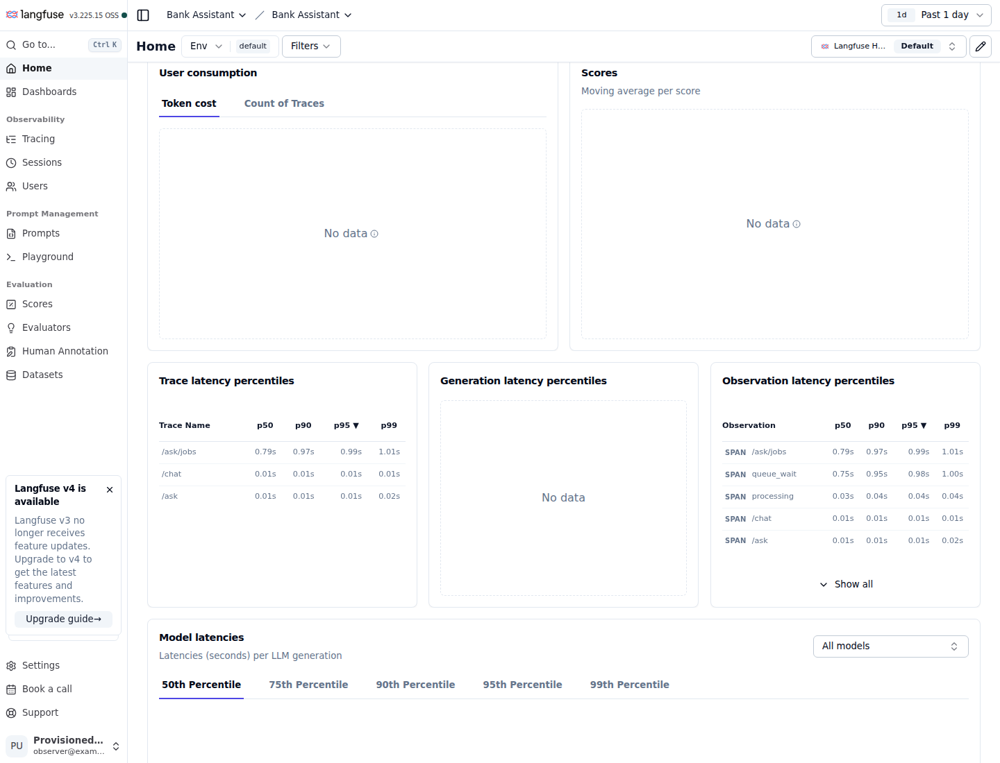
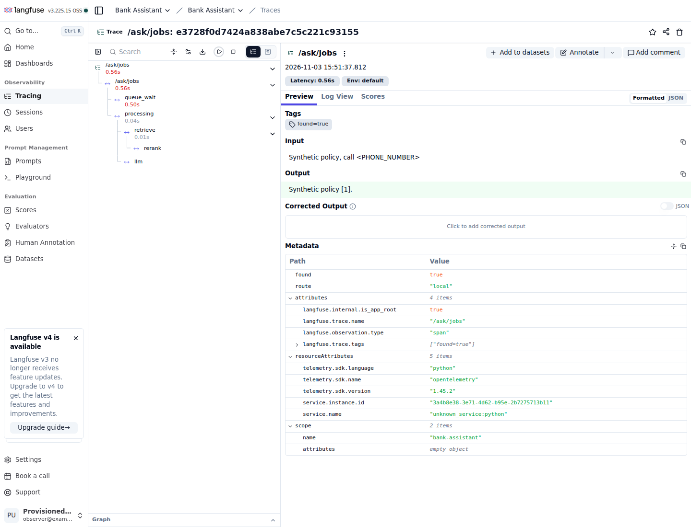

# Thiết kế observability (FR-10, owner B)

Langfuse tự host (compose profile `obs`), ghim phiên bản `<5` cho Python 3.10. Input được che trước khi ghi trace (`capture_input=False` + input đã che).

## T-035: chạy local

Python SDK `langfuse==4.18.0` và server/worker `3.225.15` được ghim riêng. Stack `obs`
gồm web, ingestion worker, PostgreSQL, ClickHouse, MinIO (ghim digest) và Redis riêng.
Chỉ dashboard/OTLP web mở `127.0.0.1:3000`; các kho obs không mở port host, có volume
và healthcheck. Core API/worker không phụ thuộc profile này và không nhận mật khẩu kho obs.
Cấu hình dựa trên [Compose upstream v3.225.15](https://github.com/langfuse/langfuse/blob/v3.225.15/docker-compose.yml).

Trong `.env.local` (không commit), điền `LANGFUSE_PUBLIC_KEY=pk-lf-...`,
`LANGFUSE_SECRET_KEY=sk-lf-...`, `LANGFUSE_ADMIN_EMAIL`, `LANGFUSE_ADMIN_PASSWORD`.
Các key do người vận hành sinh ngẫu nhiên được dùng để tạo project ban đầu; nếu volume
đã có project, dùng API keys của project đó. Thay các giá trị mặc định local của
`LANGFUSE_DB_PASSWORD`, `LANGFUSE_AUTH_SECRET`, `LANGFUSE_SALT`,
`LANGFUSE_CLICKHOUSE_PASSWORD`, `LANGFUSE_REDIS_PASSWORD`, `LANGFUSE_S3_PASSWORD`
bằng chuỗi ngẫu nhiên; `LANGFUSE_ENCRYPTION_KEY` cần đúng 64 ký tự hex.

```bash
docker compose --env-file .env.local -f infrastructure/compose.yaml --profile obs up -d --wait --wait-timeout 300 langfuse langfuse-worker
# Khởi động/recreate api và worker sau khi điền API keys.
make up
```

Mở `http://localhost:3000`, đăng nhập tài khoản vừa bootstrap, chọn project Bank Assistant.
API/worker trong Compose dùng `http://langfuse:3000`; chạy Python ngoài container thì dùng
`LANGFUSE_BASE_URL=http://127.0.0.1:3000`. Thiếu một trong hai key: tracing không import SDK,
không tạo exporter/thread và không gọi mạng. `AskResponse.trace_id` giữ `null` với answerer
mặc định khi tracing tắt. Bật tracing: trường này là trace ID OTEL 32 ký tự hex thực,
trùng trace đã export và audit; polling job giữ cùng ID. Telemetry lỗi không đổi kết quả nghiệp vụ.

## Dữ liệu và span

Không dùng decorator tự capture tham số: manual instrumentation tương đương
`capture_input=False, capture_output=False`. Chỉ question/message đã che và answer được
truyền tường minh; che lại tại sink, kể cả chuỗi JSON có escape. Không ghi user object,
API key, prompt/context tài liệu, exception message hoặc stack trace. Lỗi span chỉ ghi
`Operation failed`. Exporter chỉ nhận scope `bank-assistant`; không tự thu span thư viện khác.

| Root / span | Ý nghĩa |
|---|---|
| `/ask` | Từ sau kiểm tra/masking input đến answerer trả kết quả; metadata found/route |
| `/chat` | Structured chat và kiểm tra schema; metadata intent/needs_human |
| `retrieve` | Retrieval của RAG, kể cả embed và rerank; metadata số hit/mode |
| `rerank` | Cross-encoder trong nhánh hybrid_rerank, con của retrieve |
| `llm` | Lệnh gọi model; không chứa prompt/output tự capture |
| `/ask/jobs` | Từ thời điểm RQ enqueue đến hoàn tất callable worker |
| `queue_wait` | Timestamp RQ enqueued_at đến lúc worker bắt đầu xử lý; không phải sleep giả |
| `processing` | Thực thi worker gồm chờ rate-limit, backoff và các lần gọi answerer |

`queue_wait` và `processing` là hai span cùng cha, không chồng thời gian. Job cũ không có
enqueued_at không tạo span wait. Root worker được backdate về enqueue để total latency gồm wait.
Timestamp RQ dùng UTC; các máy chạy API/worker cần đồng bộ đồng hồ. HTTP root không gồm
xác thực, masking ban đầu, serialize hoặc audit sau handler; dùng log HTTP cho end-to-end latency.
Flushing ở shutdown API và cuối mỗi job vì RQ work horse có thể thoát ngay sau job.

## Kiểm chứng

```bash
pytest tests/unit/test_tracing.py
pytest tests/integration/test_gateway_config.py -m integration
# Export các LANGFUSE_* từ .env.local vào shell; không in key ra log.
TRACING_LIVE_TEST=1 pytest tests/integration/test_tracing_live.py -m integration
```

Live smoke dùng 20 request `/ask`, một `/chat`, hai worker call, Qdrant in-memory,
embedding/reranker/model có kịch bản và fakeredis. Nó kiểm tra ingestion SDK thật tới
stack local, ID trả về tồn tại, PII tổng hợp bị che và cây span đúng. Đây là bằng chứng
observability trên dữ liệu tổng hợp, không chứng nhận latency/model/corpus production.
Trace list đọc lại có thể trễ sau batch ingestion; smoke cho phép tối đa 90 giây.

Trong dashboard, chọn khoảng thời gian chứa smoke; xem latency percentile p95 và lọc
trace name `/ask` hoặc `/ask/jobs`. Mở một trace job: timeline có queue_wait và processing,
với retrieve → rerank và llm nằm dưới processing. Không cộng retrieve với rerank vì lồng nhau.
Kiểm tra local 2026-11-03: live smoke pass, 23 trace được ingest. Ảnh dưới đây là
dashboard Langfuse thật trên dữ liệu tổng hợp, model/embedding/reranker có kịch bản.
p95 trong ảnh không phải benchmark RAG/model production.



Trace job `e3728f0d7424a838abe7c5c221c93155`: queue_wait 0,50s, processing 0,04s,
total 0,56s (có overhead giữa các span); input đã được thay bằng `<PHONE_NUMBER>`.



## Các task tiếp theo

Token/chi phí và feedback thuộc T-036; T-037 xử lý rate limit/audit HTTP.
T-035 chỉ cung cấp timing, trace ID và dữ liệu an toàn.
Không thay contract `AskResult`/`AskResponse`.

| Chỉ số | Nguồn |
|---|---|
| Latency p50/p95 theo endpoint | thời lượng trace |
| Thời gian chờ trong hàng vs thời gian xử lý | timestamp của các span trong job |
| Token và chi phí theo request / theo ngày | `llm_cost.cost_of()` (T-036) |
| Tỉ lệ từ chối | tag `found=false` |
| Feedback 👍/👎 | `POST /feedback` → score trong Langfuse (T-036) |
